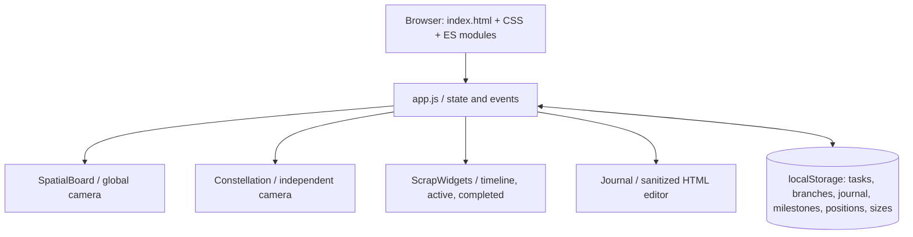
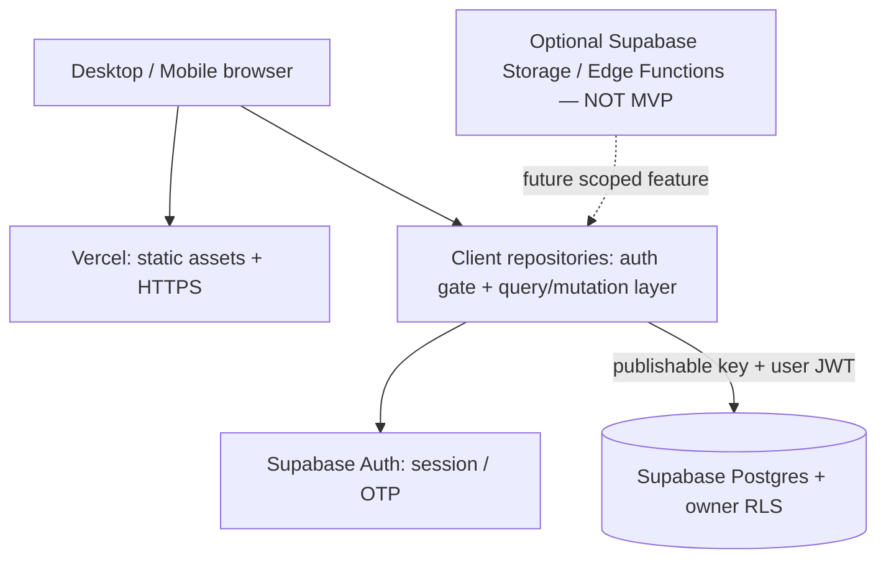

# 06 — Production system architecture (proposed, not yet activated)

## M1 current local runtime

M1 retains this native-module architecture. New dates.js centralizes Jakarta civil dates; backup.js validates snapshots and uses write-ahead originals for recoverable multi-key restoration. Storage corruption blocks ordinary overwrite; journal/layout still have their existing independent keys, with coordinated import persistence before view hydration. Cloud adapters remain inactive. See [M1 evidence](decisions/M1-IMPLEMENTATION.md).

## Architectural decision: retain vanilla ES modules

`index.html` imports `src/app.js` and `src/styles.css`; modules use browser DOM APIs, CSS, and local model utilities. There is **no Next.js/React/Vite dependency**. Vercel can host the app as static assets. Migration to another framework would rewrite the spatial camera/graph/editor integration and introduce avoidable regression and bundle weight. **No framework migration is approved**; evaluate only if direct performance/integration evidence requires it (ADR required).

## Existing (V6) runtime

All branches and tasks live in `app.js` memory. Widgets and constellation are **projections** of that same state. `readTasks/readBranches` load demo records when storage does not exist. `src/journal.js` persists pages independently, and `src/board.js` persists positions/sizes independently. No remote requests, authentication or APIs exist.

## Target architecture after milestones 2–3

### Frontend

- Preserve V6 DOM and CSS. Add an `AuthGate` module that **does not mount or reveal private data** until authenticated session loading completes; export a minimal login view.
- Use existing `src/model.js`, `src/layout.js`, and `src/data.js` for pure transformations.
- Introduce repository interfaces over `src/cloud/mappers.js` so data handling is injectable/testable; do not scatter `.from()` calls across `board.js` or `journal.js`.
- **Canonical state:** Supabase rows after login. In-memory state for current editing session. `localStorage` only for camera/cache and an explicitly recognized, non-secret unsynced draft with safeguards.
- Use a single mutation queue per user, or version-aware entity writes, to avoid silent last-writer-wins across devices.
- Debounce journal autosave, flush on explicit navigation/visibility changes; provide pending, saved, error and retry states.

### Backend & API

- For CRUD of owner-private rows, prefer Supabase Data API via `@supabase/supabase-js` **after installing a version-pinned dependency**. No custom Vercel function is necessary for ordinary CRUD when RLS is correct.
- Authentication via Supabase Auth. Static shell + client session lifecycle is not an authorization boundary; all private rows still require RLS.
- Write server/Edge Functions only for functions needing secrets or privileged integrations (future Classroom or push scheduling), with authenticated JWT validation and per-user authorization; no service-role key in browser.
- No realtime requirement for first release; cross-device changes can refresh on focus or be fetched on demand. Consider realtime only if it demonstrably improves user experience.

### Database/persistence

Seven private tables: `profiles`, `branches`, `tasks`, `journal_entries`, `milestones`, `widget_layouts`, `preferences`; actual SQL in `supabase/migrations/20261101140000_orbit_initial_schema.sql`. Branch/task IDs intentionally remain **strings** to preserve V6 JSON backup compatibility; user identity uses `auth.users.id` UUID.

### Storage

V6 stores **URL references**, not uploaded bytes. Do not create a Supabase Storage bucket in this handoff. When attachments become a scoped feature, add a private bucket and `storage.objects` policies with object path scoped to `auth.uid()`, signed downloads, file size/type rules, and deletion lifecycle.

### Security

- Supabase Auth with signups disabled and owner provisioned out of band. Browser key is publishable; no service-role/secret key anywhere in frontend, static build or GitHub.
- Per-operation RLS SELECT/INSERT/UPDATE/DELETE checks owner equality. Composite FKs `(owner_id, id)` disallow referencing another owner's branch.
- Sign-out clears private DOM/state and cancels inflight writes. Token expiry re-gates. Static deployment itself still exposes public CSS/JS and should not be confused with protected personal content.
- Private Vercel **preview deployment** access protection checked separately; actual production release requires real Auth + RLS.

### Error handling

`E_AUTH_REQUIRED`, `E_FORBIDDEN`, `E_VALIDATION`, `E_CONFLICT`, `E_NETWORK`, `E_STORAGE`, `E_IMPORT` are proposed application error codes (not implemented). Display a short inline status and preserve local uncommitted drafts. Never log journal bodies. Validate server response and do not show `Saved` until the server confirms.

### Environment / deployment

- Vercel project: framework preset **Other**, root `.`, `npm run build`, output `dist`, Node 22.
- `.env.example` contains **future-only** cloud values. The current native JS build does **not** inject environment variables. During integration implement a deliberate public-only runtime config generator or equivalent, with keys explicitly allowlisted.
- Keep separate preview and production Supabase projects or branches where feasible. Never point test builds containing sample seeding at the real private database.

### Non-goals

No Next.js rewrite, microservices, ORM, websockets, server-side rendering, AI agent server, or production cron jobs without a specific requirement. Keep the offline V6 preview intact while migrating functionality behind tested interfaces.
