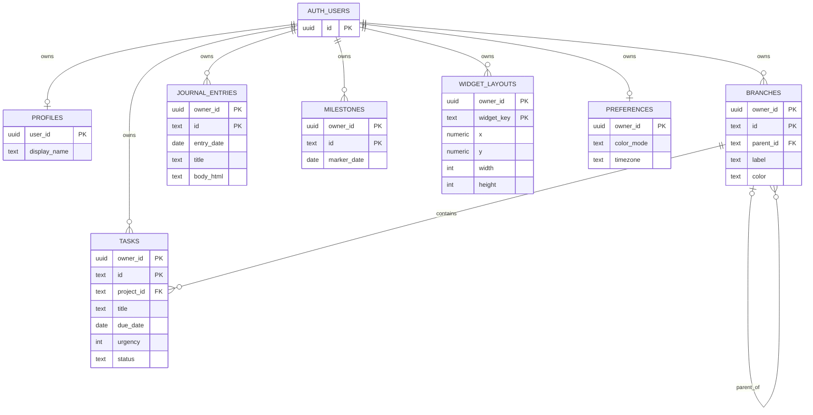

# 07 — Data model, ERD, migrations and integrity

**Authoritative schema draft:** `supabase/migrations/20261101140000_orbit_initial_schema.sql`. Written offline from the actual V6 record types. PostgreSQL/Supabase execution has **not** occurred; local CLI `supabase db reset` and row-isolation tests are required before approval.

## Entity relationships

`BRANCHES` -> `BRANCHES` and `TASKS` -> `BRANCHES` use **composite foreign keys** `(owner_id,parent_id)` and `(owner_id,project_id)`; the Mermaid diagram abbreviates those for readability.

## Tables and field mapping

| Table | Key(s) | Relevant fields | V6 data |
|---|---|---|---|
| `profiles` | `user_id` | `display_name` | future personalization of fixed HISYAM root |
| `branches` | `(owner_id,id)` | `parent_id` (NULL for virtual root), `label`, `color` | `DEFAULT_BRANCHES` + user-created nodes |
| `tasks` | `(owner_id,id)` | `project_id`, `title`, `status`, `criteria`, `description`, `due_date`, `urgency`, `effort_minutes`, `resource_url`, `completed_at` | `cleanTask()` shape |
| `journal_entries` | `(owner_id,id)` | `entry_date`, `title`, `body_html`, timestamps | `Journal.entries` |
| `milestones` | `(owner_id,id)` | `marker_date`, `title` | `milestones` array in `src/app.js` |
| `widget_layouts` | `(owner_id,widget_key)` | `x`,`y`,`width`,`height` | `SpatialBoard.getLayout()` |
| `preferences` | `owner_id` | `color_mode`, timezone | current `colorMode` plus future timezone |

## SQL design choices

- Retain V6 human-readable/string keys such as `inbox`, `demo-1`, `branch-*`, `journal-*` rather than regenerate UUIDs; owner_id is a UUID from Supabase Auth.
- Enforce length/status/urgency constraints mirroring `src/model.js`. Enforce URL begins with http/https, then also validate with `new URL()` in code.
- `parent_id = NULL` represents virtual `root`; `src/cloud/mappers.js` converts both ways.
- Reject direct cycles with `CHECK` and longer ancestor loops using an **invoker** trigger. Avoid security-definer public functions.
- `ON DELETE NO ACTION DEFERRABLE` on parent/task relations prevents accidental subtree/task loss while supporting ordered transactions. Codex must define a deliberate branch deletion UX/transaction.
- SQL `updated_at` is refreshed by an invoker trigger; client updates should not presume their timestamp wins. For sync, add an explicit version column or compare-and-swap mechanism after reviewing race behavior.
- `owner_id` leading indexes support RLS and timeline/branch queries. Journal index `(owner_id,entry_date DESC)`.

## Expected queries

- Initial load: `branches` ordered client-side by tree, `tasks` filtered `owner_id`, `journal_entries` by `entry_date`, `milestones` by `marker_date`, `widget_layouts`, `preferences`.
- Active list: tasks `status != completed`, sort locally according to color mode, or server order for scale.
- Completed list: tasks `status = completed` order `completed_at desc`.
- Timeline: tasks with non-null due date; milestones by marker_date; journal pages with nonempty title/content by entry_date.
- No joins that bypass RLS; normal Data API calls inherit user JWT.

## Development seed

`supabase/seed.sql` inserts **synthetic records only if** a local Auth account with `orbit-dev@example.invalid` exists. It does not create a real user or insert diary data for anyone else. This email is explicitly a development fixture, not a valid login credential.

## Migration and validation

1. On Codex machine, install Supabase CLI and verify `npx supabase --version`, `npx supabase migration --help`.
2. Compare existing SQL with the CLI-generated migration convention; this offline file follows `<timestamp>_<name>.sql`, but **was not produced by running the CLI**. If required, create new migration with `npx supabase migration new orbit_initial_schema` then transfer SQL and remove the replaced file. Do not generate duplicate competing migrations.
3. `npx supabase start`; `npx supabase db reset` (LOCAL ONLY, destructive to local data).
4. `npx supabase test db`, policy-isolation tests and advisors. Fix schema errors before connecting any real user.
5. Verify anon access denied, Alice cannot read/write Bob's rows; Alice cannot link a task to Bob's branch; tree cycles and orphan deletions fail; valid owner transactions pass.
6. Never apply this file unreviewed to an existing production database.

## Storage decision

No Storage bucket/policy currently necessary; V6 only links to external resources and offers local JSON/Markdown downloads. Do not fabricate a bucket or a sharing model.
