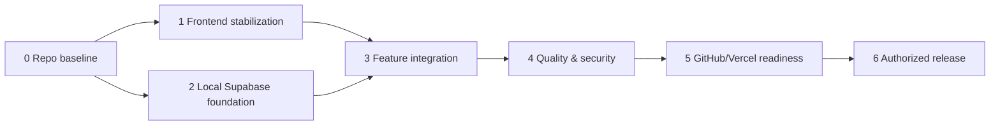

> **Historical milestone plan, written before launch.** ORBIT 1.0.0 is now owner-confirmed working in Production (7 November 2026), although some scoped tests remain unverified. This file preserves the original M0 → M1 → M2 → M2.5 → M3 → M4 → M5 → M6 plan; for *actual results* see [PROJECT_HISTORY.md](PROJECT_HISTORY.md) and [OPERATIONS.md](OPERATIONS.md). Do not treat the old NO-GO status below as current.

# 14 — Codex implementation roadmap (incremental, reviewable)

## Current approved delivery sequence

- M0 baseline and M1 frontend stabilization: completed; M1 merged.
- M2: **conditionally accepted by the owner for protected, password-based private use** on 6 November 2026 (Asia/Jakarta). Hosted read isolation and browser workflows passed; completed local tests passed. Physical-device and hosted write/CRUD authorization gaps remain documented accepted limitations. See [close-out](decisions/M2-HOSTED-CLOSEOUT.md) and [preserved evidence](evidence/m2/acceptance-20261106/manifest.json). No production/public release is authorized.
- M2.5: **P0/P1 implemented and locally verified** on `codex/m25-motion-polish`, following explicit autonomous implementation approval. [Results and limits](decisions/M2_5-IMPLEMENTATION.md): 156 unit tests, 25 motion browser cases, existing cloud regressions green. P2 deferred for lack of concrete usability evidence. Reviewable branch; no merge or deployment.
- M3: **1.0.0 release candidate prepared; Production NO-GO pending live gates.** The owner supplied authoritative issue #2 scope and conditional protected-private publication authority. [GO/NO-GO](decisions/M3-READINESS-CHECKPOINT.md) records Production target/configuration/Auth/protection, hosted write validation and final CI gaps. Build/artifact guards, tests, release notes and rollback procedures are implemented; no deployment or live mutation performed.

The original plan below is retained as historical context. Its milestone numbering and local-only M2 boundary have been superseded by the explicit user authorization above.

## Historical delivery state

M0 is complete. Owner-authorized M1 engineering implementation and simulated acceptance are complete with [command, visual and risk evidence](decisions/M1-IMPLEMENTATION.md). Physical-device/full assistive-technology follow-up remains open before release. M2 and all deployment/database gates remain separate; no production readiness or cloud integration is implied.

**Rule:** Complete one milestone at a time; capture commands, outputs, screenshots, and diff evidence in PRs. Update this roadmap and `docs/15-DECISIONS-AND-ASSUMPTIONS.md` when an assumption changes. **Never silently deploy or migrate a real remote database.**

## Dependency graph

M1 and parts of M2 can proceed in separate branches after M0, but both touch `src/app.js` integration decisions; coordinate interface contracts first. Suggested PR units are small and independently reversible.

## Milestone 0 — Repository initialization and evidence baseline

**Objective:** trust the source before changing behavior.

- **Prerequisites:** user downloads ZIP; Node 22/npm, optional Python/Chromium; no GitHub credentials required.
- **Scope/files:** `index.html`, `src/*`, `assets/*`, `package*.json`, `scripts/*`, `.gitignore`, `docs/reference/V6_SOURCE_MANIFEST.json`, `tests/*`.
- **Steps:** inspect SHA manifest; `npm ci`; run `npm run lint`, `npm test`, `npm run build`, `npm run verify:structure`; run a browser origin smoke; inspect `git status`, identify untracked personally identifying files; preserve baseline screenshots.
- **Acceptance:** source hashes for `index.html` and original V6 `src/*`/`assets/*` match manifest; builds into `dist` correctly; all relevant original unit and browser checks pass. If browser test fails, characterize environment vs product defect.
- **Verification:** `npm run check`; `python tests/qa_v6.py` if deps installed; `git diff --stat` (after repo init). No `git push` in this task.
- **Definition of Done:** baseline report in `docs/decisions/M0-BASELINE.md`, command log and issues with severity; no auth, DB or design change.
- **Rollback:** discard only M0-specific testing changes; restore original archive if necessary. No persistent data impacted.

## Milestone 1 — Frontend stabilization (no redesign)

**Objective:** improve reliability/accessibility of the existing V6 experience without altering spatial identity.

- **Depends on:** M0.
- **Scope/files:** `src/board.js`, `src/constellation.js`, `src/widgets.js`, `src/journal.js`, `src/styles.css`, `tests/`, screenshots. No framework migration.
- **Steps:** add real-origin browser E2E, screenreader/keyboard ordering, high-contrast and text-scale QA; fix milestone two-click removal with understandable Undo, harden CSV edge cases, test saved/unsaved indicators, eliminate only confirmed overlap/performance bugs. Maintain original V6 screenshots for intentional regressions.
- **Acceptance:** all core controls accessible on simulated desktop/tablet/320/390 mobile; task/milestone/journal flows retained; visual diffs deliberate; no new card-grid or tabs.
- **Verification:** `npm run check`; targeted E2E, screenshot comparisons, physical-device follow-up.
- **Definition of Done:** tests pass, UX issues prioritized and annotated in `docs/05-UI-UX-DESIGN-SYSTEM.md`, screenshots reviewed.
- **Rollback:** revert affected UI commit while preserving same V6 state model and JSON backup format.

## Milestone 2 — Supabase foundation (local only)

**Objective:** establish tested owner-only storage and auth boundaries before private content sync.

- **Depends on:** M0; align entity mapping with M1.
- **Scope/files:** `supabase/config.toml`, `supabase/migrations/*.sql`, `supabase/tests/*.sql`, `src/cloud/*`, new `src/auth/*`, `.env.example`, lockfile.
- **Steps:** install reviewed CLI & `@supabase/supabase-js`, run CLI help; use CLI-generated migration convention; boot local stack; apply SQL locally; pgTAP tests for RLS allow/deny and owner-FK; enable single owner via Auth; implement AuthGate, session restore/logout; build public-only config injection (static JS has no import.meta.env); verify no privileged browser keys.
- **Acceptance:** anon and other owner cannot read/write; owner can CRUD each table; direct forged owner_id blocked; separate local account A/B tests pass; frontend still shows no private content before auth.
- **Verification:** `npx supabase start`, `npx supabase db reset` (LOCAL only), `npx supabase test db`, `npx supabase db advisors` if supported, `npm run check`, auth E2E.
- **Definition of Done:** RLS/DDL tested on local Postgres, schema migration reviewed, secrets excluded, auth boundary documented.
- **Rollback:** restore prior local schema via local reset; no production migration, preserve local JSON backups.

## Milestone 3 — Connect every V6 feature to backend

**Objective:** one shared owner-specific source of truth, no lost interactions.

- **Depends on:** M1 + M2.
- **Scope/files:** `src/app.js`, `src/storage.js` (new adapter interface), `src/cloud/*`, `src/journal.js`, `src/board.js`, `src/widgets.js`, auth UI, new integration tests.
- **Steps:** hydrate snapshot after verified login; wire branches then tasks CRUD, completion, task rails and timeline; journal autosave/timeline markers; milestones, layout, preferences; implement pending/error/retry; explicit opt-in V6 JSON import; transactional/rollback strategy; test signed-in second-device and offline edits.
- **Acceptance:** task, branch, journal, marker and window positions survive refresh and sync across signed-in devices; completed remains off active map; only one canonical task record; failed writes do not claim success; import never silently overwrites.
- **Verification:** `npm run check`, local Supabase integration/E2E, offline/expired-session/conflict tests, import roundtrip.
- **Definition of Done:** every production-action row in `docs/10-FRONTEND-BACKEND-MAPPING.md` has an actual tested implementation.
- **Rollback:** feature-flag switch back to safe local read-only/demo without losing unsynced drafts; preserve DB state, do not delete tables.

## Milestone 4 — Testing, security and performance gate

**Objective:** prove actual owner privacy and end-to-end usability.

- **Depends on:** M3.
- **Scope/files:** `tests/`, `supabase/tests/`, error messages, CSP headers, monitoring hooks (redacted), possibly editor internals.
- **Steps:** robust browser E2E against real localhost origin, row-isolation tests, XSS/HTML import, CSV formulas, branch cycles, concurrent edits, 100/500/2000-task stress; physical Safari/Android, reduced motion/transparency, keyboard/VoiceOver. Consider replacing deprecated journal `execCommand` with structured editor in its own PR and full regression suite.
- **Acceptance:** no P0 security/data loss; relevant WCAG checks, mobile workflow, no unintended status changes; documented performance in representative devices.
- **Verification:** Node tests, browser E2E, `supabase test db`, security advisors, static build, manual real-device test log.
- **Definition of Done:** evidence recorded in security checklist, known risks owner-accepted or fixed; formal release gate signed off.
- **Rollback:** revert isolated changes, keep DB backward-compatible; stop rollout if P0 failures.

## Milestone 5 — GitHub and Vercel readiness

**Objective:** make tested build deployable via protected Git workflow, not to release blindly.

- **Depends on:** M4.
- **Scope/files:** `.github/workflows/quality.yml`, `vercel.json`, `docs/11-GITHUB-SETUP.md`, `docs/12-VERCEL-DEPLOYMENT.md`, exact URL/Auth config.
- **Steps:** user creates private repo; enable branch protection/required checks; user imports repo to Vercel, selects Other/root `.`/Node22; enable Vercel Authentication **All Deployments**; configure separate staging Supabase env and allowed Auth URLs; check preview build and browser flows without real personal data.
- **Acceptance:** CI green in GitHub; protected preview inaccessible anonymously; no 404 or exposed backups; staging owner flow passes.
- **Verification:** GitHub Actions logs, Vercel build logs, incognito access challenge, staging login smoke, direct RLS probe.
- **Definition of Done:** environment and release target explicitly approved, preview checklist signed, no production migrations executed implicitly.
- **Rollback:** disable/rollback preview, un-link if needed; DB remains unaffected.

## Milestone 6 — Authorized production release

**Objective:** publish a privacy-preserving, recoverable personal workspace after user authorization.

- **Depends on:** M5, reviewed production DB migration, owner approval.
- **Scope/files:** production Supabase settings/migrations, Vercel production config, monitoring, operational runbook.
- **Steps:** backup and review migration diffs; apply non-destructive production migration manually after approval; set exact Auth redirect URLs; stage reviewed build; smoke-test real sign-in CRUD and cross-owner isolation; ensure access protection; release with monitored rollout, identify rollback version.
- **Acceptance:** protected production endpoint; real owner can sign in/out and sync, nonowner denied, journal encrypted in transit, no sensitive logs, backup/export proven, rollback procedure available.
- **Verification:** documented staging-vs-prod migration list, `npm run check`, live synthetic smoke, Vercel status/logs after release, SQL advisers and RLS test.
- **Definition of Done:** recorded URL/commit/environment/status, human approval, monitoring, data retention/export and incident response notes.
- **Rollback:** revert Vercel deployment and use documented DB backward-compatible recovery; never perform unreviewed destructive rollback.

## Open decisions requiring human input

Single owner auth method (email OTP vs another approved provider), exact Vercel project/domain, whether All Deployments protection should stay on after Auth, backup import overwrite/merge preference, journal privacy/encryption expectations, physical devices for acceptance, and allowed error telemetry. No need to resolve these to complete M0.

## Evidence convention

Each PR/task log should include `Objective`, `Source files`, `Changes`, `Commands + exit codes`, `Screenshots`, `Security`, `Known issues`, `Rollback`. Never replace a failed command with a narrative claim that it passed.
